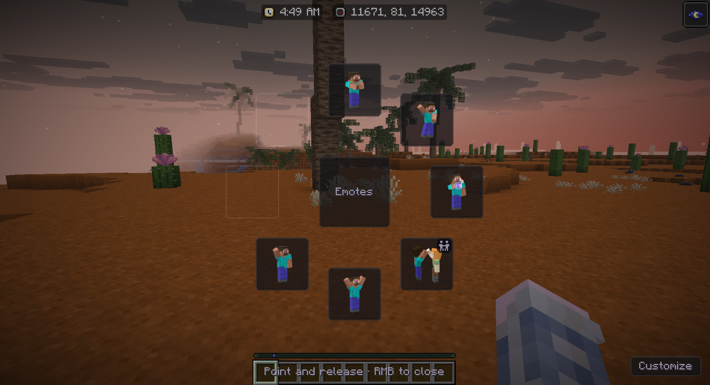
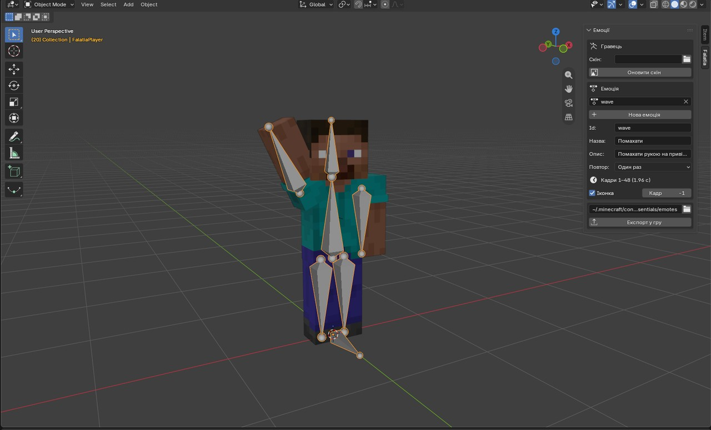

 <p align="center">
  
</p>

<h1 align="center">Falatia Emotes</h1>

<p align="center">
  Самописний модуль, для програвання ваших емоцій під час гри (витягнутий з оригінального коду Falatia Essentials)
</p>

<p align="center">
  
</p>

Що таке Falatia Emotes, це клієнтський Fabric мод для версії майнкрафту 26.3, який розроблений був спеціально для проєкту Falatia, але з часом було прийнято рішення, віддокремити його, для граців і спільноти українських майнкрафт серверів.


**Можливості моду Falatia Emotes:**

- Можливість відкрити колесо емоцій використовуючи клавішу **B**
- Згинання кінцівок моделі персонажа, тобто присутня можливість згинати будь-яку частину тіла, не тільки на 45 і 90 градусів, а і так як це буде потрібно для конкретної емоції
- Присутня також функціонал парних емоцій, гравець може створити парну емоцію завдяки аддону для blender, і тоді цю емоцію можна буде відтворити, одночасно двум гравцям, з різними позами і ключами анімації
- Також якщо у двох різних гравців присутня одна і та сама емоція в бібліотеці емоцій, у вас буде можливість відтворити її якщо ви підійдете до іншого гравця який вже грає цю емоцію, для цього потрібно буде натиснути **G**

## Встановлення

Для коректної роботи моду потрібно встановити Fabric 26.3 і Fabric Api не нижче 0.19.5 версії, мод достатньо буде перемістити в папку модів `mods`.

Якщо у вас є свій сервер, і ви хочете щоб мод працював на ньому і інші гравці могли бачити чужі емоції, для цього вам потрібно встановити плагін на ваш сервер [FalatiaEmotesPlugin](https://github.com/happyz3ne/FalatiaEmotesPlugin) (Доступно лише для серверів Paper 26.3)

## Як встановити кастомні емоції

Директорія де зберігаються емоції знаходиться в папці гри по шляху `config/falatia-emotes/emotes/` після чого вам потрібно буде закинути сюди файл емоції json, або-ж архів з емоціями якщо він присутній. Також є можливість додати png картинку до вашої емоції (Назва картинки повинна відповідати назві самої емоції) Після чого емоція появиться в вашому списку моментально.

## Як створити свою емоцію у Blender

<p align="center">
  
</p>

Щоб завантажити аддон можете його взяти з актуальних релізів, або-ж в цьому-ж репозиторії по шляху `tools/blender/`
(Для коректної роботи аддону треба версія блендеру не нижча за 4.4)

1. Для початку потрібно встановити сам аддон `tools/blender/falatia_emotes-1.5.0.zip` запусти Blender, потім Edit → Preferences → Get Extensions → стрілка випадаючого списку → Install from Disk.
2. Опціонально в налаштуваннях аддону можна вказати теку гри куди будуть експортуватись емоції які ви зробите (за замовчуванням — `~/.minecraft/config/falatia-emotes/emotes`) також можна вказати ваш нікнейм, він буде відображатись у полі автора в списку емоції.
3. Далі відкрий вкладку Falatia на боковій панелі 3D Viewport (Відкривається клавішою N).
4. Натисни Create Player. І на сцені появиться ріг який вже можна анімувати використовуючи ключі анімації в блендері, також на сцені буде створена камера, яка використовується для створення автоматичної іконки для емоції, і можливість обрати режим рігу з згибами кінцівок і без.
5. Потім New Emote. І потрібно вказати id емоції це буде її назва яка буде зберігатись в файлі і буде її назвою, також потрібно вказати назву емоції опис, і присутні режими відтворення (once, loop або hold).
6. Анімуйте. Також є можливість додати в анімацію партікли і звуки, можливо вибрати тільки ті які присутні у самій грі (Для збереження стилістики) Вони додаються через відповідне вікно аддона яке знаходиться нижче.
7. Для створення парної емоції використовуй режим Make Paired. Аддон додасть другого гравця розмісти його там, де має стояти партнер, та створи для нього анімацію. Анімація першого гравця буде відтворюватись циклічно до поки другий гравець не приєднається.
8. Все. Далі натисни Export to Game, щоб зберегти `<id>.animation.json` та `<id>.png` у папку з емоціями.

## Збірка

```bash
./gradlew build
```

Готовий `.jar` файл з'явиться в `build/libs/FalatiaEmotes-1.0.0.jar`.

## Ліцензія

Falatia Source-Available License — у нашого мода присутня ліцензія яка поширюється на доступні розробки нашої команди переглянути її можна тут [LICENSE](LICENSE).